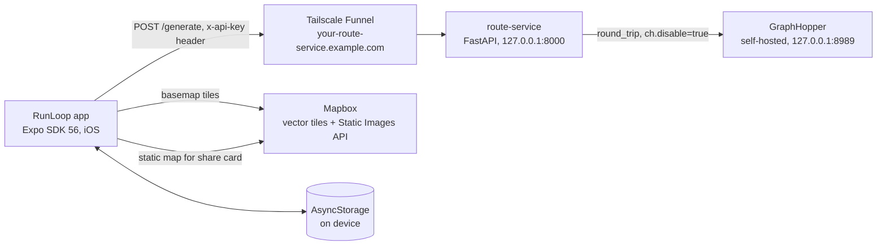
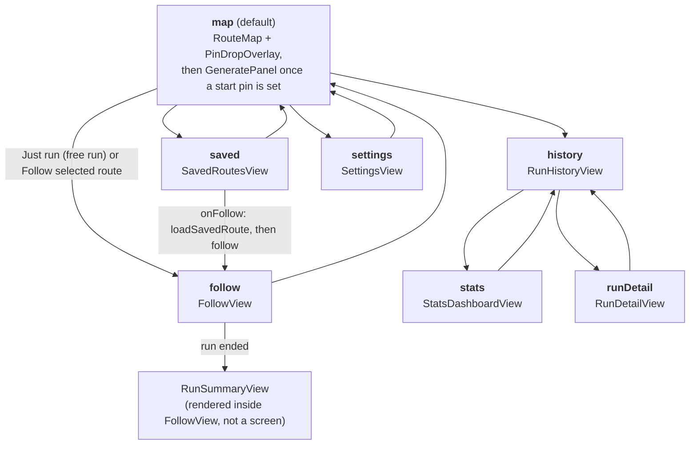
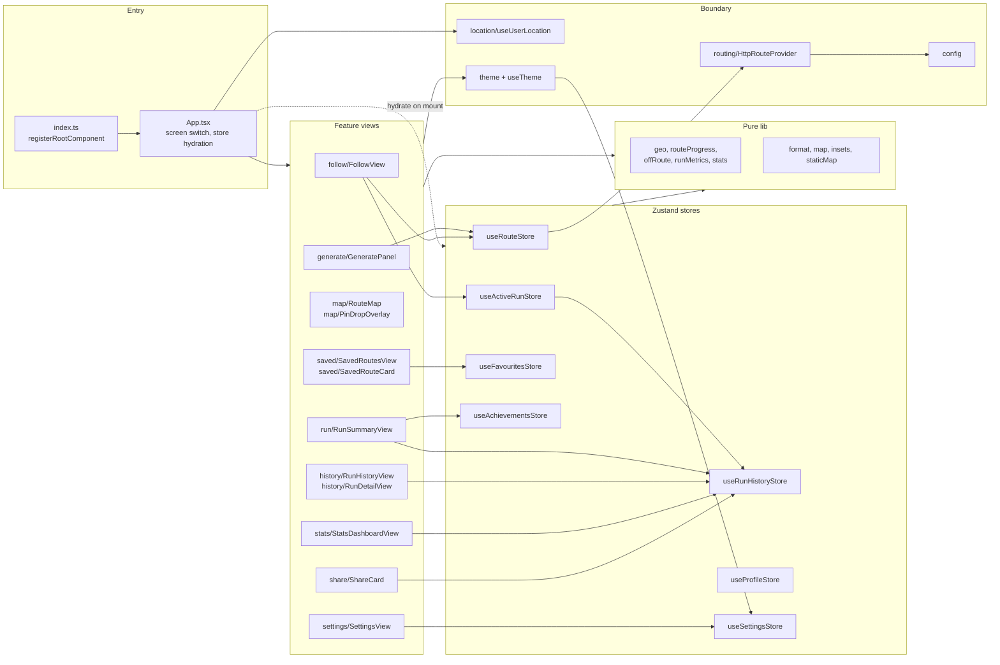
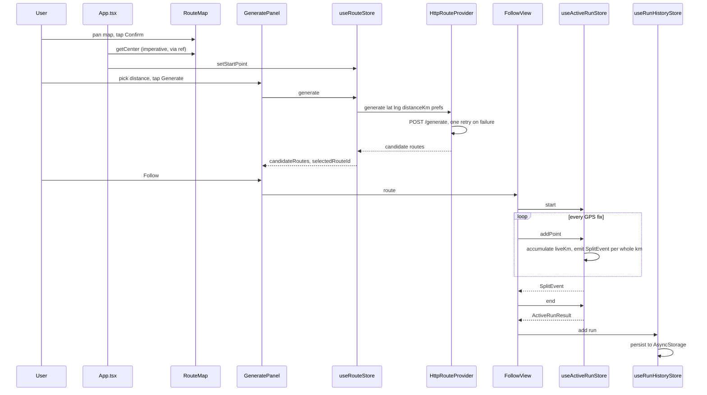

# RunLoop app architecture

Scope: the Expo app in `app/` only. The route service and GraphHopper appear as external
boxes, not as internal detail.

Snapshot taken on branch `main` (2026-07-29): 45 non-test files under `src/`, plus `App.tsx` and
`index.ts`, ~4,865 lines excluding tests.
Phase 6 background tracking (`src/location/backgroundRunTask.ts` and its wiring) lives on
`v3-phase6-background-tracking` and is **not** in this map. Re-check this file after that merge.

Regenerate the dead-code section with the method in [Dead-code sweep](#dead-code-sweep);
everything else is hand-maintained.

---

## 1. System context

The app talks to exactly one first-party endpoint: `POST {ROUTE_API_BASE}/generate`, sent from
`src/routing/HttpRouteProvider.ts`. There is no other network call to our own infrastructure, and
no backend account, session, or sync. Every byte of user data stays on the phone.

## 2. Screens

`App.tsx` is the entire router: a `Screen` discriminated union in local `useState`, switched in
`renderScreen()`. There is no navigation library and no back stack, so every `onBack` names its
destination explicitly.

Two things worth knowing before editing this:

- `handleFollowSaved` (`App.tsx:105`) calls `loadSavedRoute` then immediately reads back
  `useRouteStore.getState()`, because it needs the resolved candidate in the same tick rather
  than on the next render.
- Screens render directly, with no wrapper animation. That is deliberate. A `ScreenTransition`
  wrapper existed until 2026-07-29 and was deleted unused: a native-driven `Animated.View` around a
  Mapbox `MapView` desyncs Fabric tag registration and hangs `getCenter()`. Do not reintroduce one.

## 3. Module topology

The shape here is hub-and-spoke, not a pipeline. Seven Zustand stores are the hub; views read
them directly and `lib/` holds pure functions that neither views nor stores own.

Layer rules that hold today and are worth keeping:

- `lib/` imports nothing from `store/` or `features/`, except `stats.ts`, which imports the `Run`
  **type** from `useRunHistoryStore`. Type-only, so no runtime cycle.
- Stores never import views. Views import stores freely.
- Only `HttpRouteProvider.ts` reads `ROUTE_API_BASE` / `ROUTE_API_KEY`; only `App.tsx` and
  `ShareCard.tsx` read `MAPBOX_TOKEN`.
- `useTheme` depends on `useSettingsStore`, so theme changes propagate through the same store
  mechanism as everything else. `ShareCard` deliberately bypasses it and pins `darkTheme`.

## 4. The critical path: generate, follow, save

This is the spine. Everything else hangs off it.

Notes on this path, all confirmed in the files:

- `RouteMap` exposes `getCenter` and `flyTo` through `forwardRef` / `useImperativeHandle`, because
  `onCameraChanged` does not fire for user panning under Fabric.
- `HttpRouteProvider.generate` retries the POST exactly once, then converts the failure into one of
  two user-facing strings. The "is Tailscale on?" copy is stale (the answer is now that Tailscale
  should be **off**), noted in `CLAUDE.md`.
- `useActiveRunStore` keeps a running `liveKm` rather than recomputing the whole trace per fix, and
  fires split events through a module-level `Set` of listeners (`onSplit`), not through React state.
  `useAudioCues` is the only subscriber.
- The GPS subscription itself is `Location.watchPositionAsync` inside `FollowView.tsx:90`. It is
  foreground-only on this branch.

## 5. Persistence

Five of the seven stores persist to AsyncStorage on write and hydrate on app mount from `App.tsx`.

| Store | AsyncStorage key | Holds |
| --- | --- | --- |
| `useRunHistoryStore` | `@runloop/run-history` | completed runs, full traces and splits |
| `useFavouritesStore` | `@runloop/favourites` | saved routes |
| `useSettingsStore` | `@runloop/settings` | audio cues, theme mode, route prefs |
| `useProfileStore` | `@runloop/profile` | weight, for calorie estimates |
| `useAchievementsStore` | `@runloop/achievements-seen` | which achievements have been shown |
| `useRouteStore` | none | current start pin and generated candidates, memory only |
| `useActiveRunStore` | none | in-progress run, memory only |

`useActiveRunStore` holding no persistence is the single largest structural consequence of the
foreground-only design: if the app is killed mid-run, the run is gone. That is what Phase 6 changes.

---

## Dead-code sweep

Method: for every value export in `src/`, grep the whole app (`src/`, `App.tsx`, `index.ts`) for the
identifier, excluding the defining file and the `src/components` barrel, then check for uses inside
the defining file. Run on `main`, 2026-07-29.

### Dead: zero callers anywhere

**None as of 2026-07-29.** The sweep found three, and all three were removed the same day.

| Symbol | Was at | Why it was dead | Removed with |
| --- | --- | --- | --- |
| `ScreenTransition` | `src/components/ScreenTransition.tsx`, re-exported from the components barrel | No importer, no test. Abandoned deliberately: wrapping a Mapbox `MapView` screen in a native-driven `Animated.View` desynced Fabric tag registration and hung pin-drop confirm. The decision was recorded in `CLAUDE.md`, but the component was never removed. Its own doc comment claimed it was "safe to wrap around the Mapbox view", which is the opposite of what was learned on device. | Whole file plus the barrel line |
| `traceDistance` | `src/lib/geo.ts` | Referenced only by its own test. Superseded by `segmentsDistanceKm` (`src/lib/runMetrics.ts:14`), which is what the tracking path actually calls. | Its 4 tests in `geo.test.ts` |
| `monthlyAggregates` + `MonthAgg` | `src/lib/stats.ts` | Referenced only by its own test. `StatsDashboardView` imports `weeklyAggregates` only. Built for a monthly view that was never shipped. | Its 1 test, plus the two private helpers it orphaned: `monthStartISO` and `shiftMonthStart` |

All three were tested, so `npm test` was green with and without them. **Tests passing is not evidence
that code is reachable**, which is the reason this sweep exists as a separate check.

After removal: `tsc --noEmit` clean, 124 tests passing across 13 suites (down from 129, exactly the
5 tests that covered the deleted symbols), and a re-run of the sweep found no newly orphaned exports.

### Over-exported: used, but only inside their own file

Not dead, and not urgent. Narrowing the export surface makes the next sweep cleaner.

| Symbol | Location | Only use |
| --- | --- | --- |
| `encodePolyline` | `src/lib/staticMap.ts:5` | `staticMapUrl` at `:64` (also tested) |
| `splitAnnouncement` | `src/features/follow/useAudioCues.ts:33` | `useAudioCues` at `:52`, untested |
| `SEARCH_WINDOW` | `src/lib/offRoute.ts:7` | default argument at `:45`, untested |
| `fonts` | `src/theme/index.ts:13` | `fontAssets` and the type scale in the same file |

`MAP_STYLE_NIGHT` / `MAP_STYLE_DAY` (`src/lib/map.ts:9`, `:12`) also have no production importer
outside `mapStyleFor`, but `src/lib/map.test.ts` asserts against them directly. Keep them exported,
and keep the rule that views call `mapStyleFor(dark)` rather than importing a constant.

### Notable findings

1. **Abandoned decisions leave residue that outlives the decision.** `ScreenTransition` was a
   working component that must never be used, sitting in the shared barrel where the next person
   would reach for it, while the reason it was dangerous lived only in `CLAUDE.md`. Deleted
   2026-07-29. Worth watching for the same pattern whenever an on-device lesson retires an approach:
   the rule gets written down, the code does not get removed.
2. **`stats.ts` is the heaviest pure module** (277 lines, the largest non-view file) and carries four
   distinct jobs: aggregation, records, streaks, and achievement evaluation. `RunSummaryView`,
   `RunDetailView`, `ShareCard`, and `StatsDashboardView` each import a different subset. Nothing is
   wrong today; it is just the module most likely to need splitting next.
3. **Split events bypass React entirely.** `onSplit` in `useActiveRunStore.ts:37` is a module-level
   `Set<SplitListener>`, deliberately outside Zustand so the audio cue fires exactly once per
   kilometre rather than on every re-render. It has exactly one subscriber and no test.
4. **`useAudioCues` is untested, and it is the one hook with a lazy native require.** It
   `require`s `expo-speech` at call time so a dev client without `ExpoSpeech` still boots. Both
   halves (the announcement string and the lazy load) are unverified by the suite.
5. **`ShareCard` is the only view that reads two stores plus config plus a pinned theme**
   (`useRunHistoryStore`, `useProfileStore`, `MAPBOX_TOKEN`, `darkTheme`). It is also imported at
   module scope by `RunDetailView`, which is why a stale dev client cannot run `main` at all. The
   coupling is intentional and documented, but it makes `ShareCard` the most fragile view to move.
6. **No cycles.** `lib/` never imports `store/` at runtime; the single `store/` reference in
   `stats.ts` is a type-only import.
